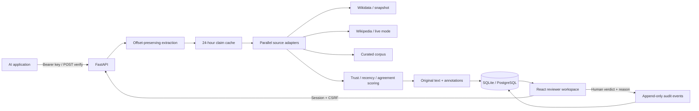
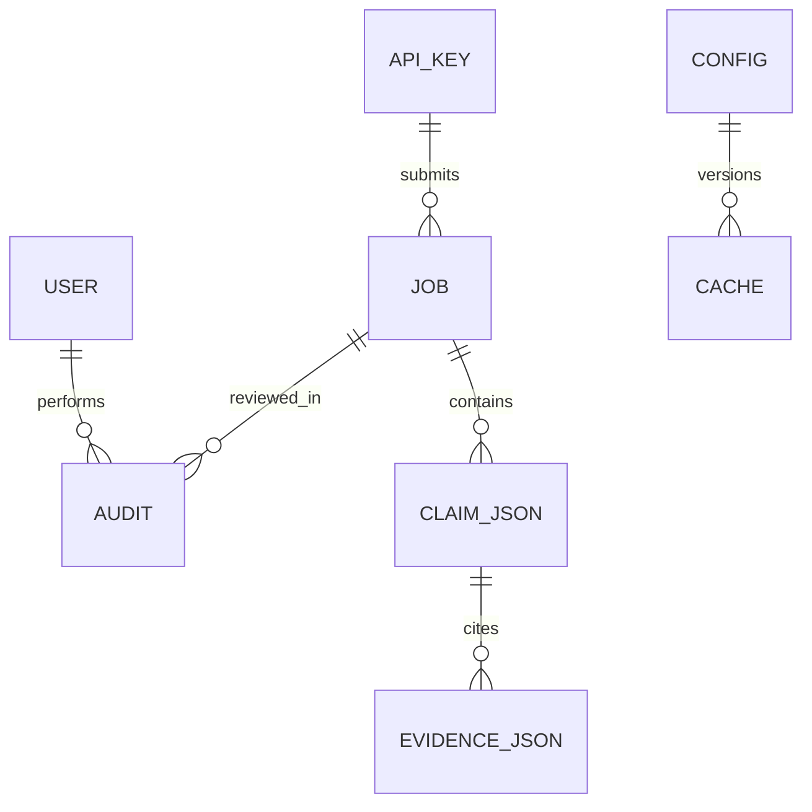

# Architecture and design

The implementation keeps extraction, source adapters, scoring/orchestration, storage/security, and the HTTP interface in separate modules. The reviewer workspace is a React application built by Vite and served alongside the JSON API. The Python SDK uses the standard library.

The database models are User, ApiKey, Job, Audit, Config, and Cache. Jobs retain immutable input, automatic verdict fields, evidence and offsets in a JSON report. Overrides update the effective verdict in that report, leave automatic fields intact, clear approval, and append a complete before/after audit event in the same transaction. The API response computes counts and scores from the effective verdicts. Audit records have no deletion endpoint.

CLAIM_JSON and EVIDENCE_JSON above are report structures embedded in Job.report, not independent relational tables. Audit.actor is a retained username; its job/claim references are in Audit.details. Configuration is a JSON record; cache keys include the complete source configuration, mode, and normalized claim text. Exact/case/punctuation duplicates reuse source results while the current threshold is applied afresh. The cache does not reuse arbitrary semantic paraphrases. Reviews apply to jobs and never poison source caches.

Every adapter implements `name` and async `query(text, client)`, returning evidence records. A wrapper enforces a source deadline and isolates provider errors. The pipeline limits concurrent claim lookups to 12 and caps the overall request deadline; a timed-out request persists a conservative Not-Checkable fallback. Successful evidence is retained when an independent source fails. The cache stores successful lookups for 24 hours, including no-match results. Failures are retried. Cache pruning and shared quotas are future operational work.

Scoring uses quality × trust weight × recency, averaged over evidence records. Recency decays over a ten-year horizon to a floor of 0.5. Support and contradiction evidence compete; ties choose Contradicted conservatively. Confidence measures support strength. Correction suggestions require contradiction strength > 0.7. This is a transparent heuristic; neither independent source sampling nor statistical calibration is claimed.

RBAC: Administrator controls configuration and keys; Reviewer can inspect jobs, approve, override, and inspect analytics; Integrating Developer uses a bearer key limited to its own job history and application identity. API keys are hashed with SHA-256, passwords use salted PBKDF2-HMAC-SHA256 with 600,000 rounds, and session cookies are signed, HttpOnly and SameSite Strict. CSRF tokens protect session-authenticated writes. HTTPS and secure cookies require deployment configuration.
